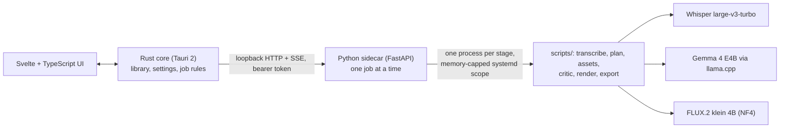

# PictureBOOK

A private, offline picture-book maker. A parent types, imports or records a story; the app turns it into a 4–10 page illustrated book (PDF) on the parent's own laptop. No account, no upload, no subscription: the child's voice and the family's story never leave the machine.

It runs three models, one at a time, on a single **8 GB laptop GPU** (RTX A2000): Whisper for speech, Gemma 4 E4B for planning and checking, FLUX.2 klein 4B for pictures. A book takes 6–9 minutes.

## What it does

1. **Story in.** Type it, import an audio file (wav, mp3, m4a, flac, ogg) or record with the microphone (English, up to 15 minutes). Recordings are deleted after transcription unless the parent asks to keep them.
2. **Plan.** The story is split into pages. Every character and place becomes a structured description (species, hair, outfit, accessories, mood, weather...) validated by pydantic models. The planner's output is grammar-constrained JSON, and fields the model had to invent are marked as guesses.
3. **Approve the characters.** The parent sees each character and place, can edit any field, redraw one character, and only then approves the pages to be drawn.
4. **Draw.** Reference pictures for every character and place, then each page composed from those references. A vision critic compares the pictures with the plan and writes warnings.
5. **Review.** Every page at full size with the computer's notes. Redraw a page (new seed), undo, compare earlier versions. Export a PDF.

## How it works



- **Rust core** owns the book library (a book is a folder; the folders are the source of truth, there is no index to corrupt), settings, and the rules for job and book status. It is tested without a GUI.
- **Python sidecar** exposes the pipeline over a loopback HTTP API with a per-launch bearer token and progress as server-sent events. It refuses paths outside the library and runs one GPU job at a time.
- **Each GPU stage is its own process** under a memory-capped systemd scope, so only one model is in memory at a time and an out-of-memory stage cannot take the desktop with it. Killing the app, even with SIGKILL, leaves no stray process and no VRAM in use (tested).
- Design docs: [architecture](docs/architecture.md), [class and API contract](docs/class.md), [UI design](docs/ui-design.md), [roadmap](docs/roadmap.md).

## What I measured

Everything below is reproducible from [`experiments/`](experiments/README.md) and written up in [`docs/research/`](docs/research/). Limits of each test are in the linked documents.

| Question | Result |
|---|---|
| Which speech model? | Whisper large-v3-turbo: 1.9% word error rate on 48 synthetic clips (8% at 0 dB noise), 2.1 GB VRAM. Parakeet 0.6B (CPU) 3.9%. Gemma 4's own audio input fabricated text in heavy noise (28.7%), so it was rejected. Only synthetic speech and 14 other clips were used, **not** real parents' recordings. [stt-bakeoff](docs/research/stt-bakeoff.md) |
| Can a small vision model check the pictures against the plan? | Gemma 4 E4B, 1120 image tokens, thinking off: 94.7% accuracy and 99% recall of deliberate mismatches, 7.5% false alarms, on 40 synthetic images. [critic-evaluation](docs/research/critic-evaluation.md) |
| Can any model find extra hands or legs? | **No.** 0 of 3 on Gemma 4 E4B and on Qwen3.5-4B. Published 2026 results for much larger models are also at or below chance (detection AUC 0.23-0.38). So a human reviews every page. [page-defects](docs/research/page-defects.md) |
| Does "Redraw" fix a bad page? | 39 redraws on 13 flagged pages: **11 of 13 defects came back in all three redraws**, only 2 were random. Redraw fixes hands and stray props; it does not fix planning problems. [story-battery](docs/research/story-battery.md) |
| Does repairing a picture by editing help? | In 6 tries it improved the page once, so a repair is kept only if the critic then finds fewer confident mismatches. |
| Does it fit the GPU? | klein 4B in NF4: 6.9 GiB PyTorch peak (7.8 GB on the board by nvidia-smi), 9.9 s per image, 44.6 s for a page composed from three references. SDXL + IP-Adapter was 3x slower with weaker prompt adherence. [image-bakeoff](docs/research/image-bakeoff.md) |

## What did not work

- **Reflections were drawn as a second real creature** (a dog beside its reflection in the water). Redrawing never fixed it, because the planner listed the reflection as a character. Fix: a reflection is now a page effect, not a character, with a code guard for planner output that still lists one. Re-run, most pages came out right; one still failed because the sentence talks to the "other dog".
- **Extreme size differences** (mouse and lion) are lost: the plan only knows short, average and tall, and the references are drawn at one scale.
- **Pages with three or four characters** are the weakest; the 8 GB card forces smaller reference pictures.
- **The vision critic is noisy.** "Page may not show..." appeared on 18 of 35 pages in the story battery and was often wrong, so its output is shown as notes for the parent, never as an automatic action.
- **Silence became a made-up book.** Whisper turns silence into "Thank you." and the planner invented a whole story from it. Found in a code review, fixed with a gate that stops with a plain message ([verification log](docs/research/verification-log.md), section 5i).
- **Rewording the story to please the image model** would have raised quality scores, but it changes what the parent said, so it was rejected.

Full list: [docs/limitations.md](docs/limitations.md).

## Status

- Working end to end on one machine: Linux (CachyOS, Wayland), i7-12800H, RTX A2000 8 GB, 15 GiB RAM. Nothing else has been tried.
- English only. A real voice recording was tested only through a prepared speech file, not with a live microphone end to end.
- Not packaged: the app starts the sidecar from the repository's `sidecar/.venv`. A first run needs about 20 GB of model downloads, done by hand (the first-run check shows the exact commands).
- Tests that need no GPU: 61 pipeline-rule tests, 95 sidecar tests, 45 Rust tests, 15 JavaScript tests, plus `svelte-check` and `cargo clippy` clean.

## Repository layout

| Path | What |
|---|---|
| `src/` | SvelteKit (static SPA) UI shown in the Tauri window |
| `src-tauri/` | Tauri 2 shell: window, commands, events; starts and stops the sidecar |
| `crates/picturebook-core/` | UI-free Rust core: book library, settings, job rules, sidecar supervisor and HTTP/SSE client |
| `sidecar/` | Python (uv) service with the loopback API; its uv environment holds torch and every pipeline package |
| `scripts/` | The pipeline stages with `run_all.py`, `regen.py`, `review.py`; `scripts/tests` needs no GPU; `scripts/demo/` has 21 test stories |
| `docs/`, `experiments/` | Design documents and reproducible measurements |

## Development

Prerequisites (Arch/CachyOS): Rust, Node, [uv](https://docs.astral.sh/uv/), `sudo pacman -S --needed webkit2gtk-4.1 patchelf`, a `llama` binary from llama.cpp, ffmpeg.

```bash
(cd sidecar && uv sync)        # Python environment incl. torch 2.12.1 (about 2 GB download, 5 GB installed)
npm install                    # frontend and Tauri CLI
npm run tauri dev              # app window + Vite dev server (starts the sidecar from sidecar/.venv)
```

Tests and checks:

```bash
(cd sidecar && uv run pytest)  # sidecar API tests
cargo test --offline           # library, settings, SSE parser, job end-to-end tests against the real sidecar
sidecar/.venv/bin/python -m pytest scripts/tests   # pipeline rules, review sheet, redraw undo (no GPU)
npm run check && npm run build # frontend type-check and build
npm run test:js                # recorder: WAV encoder and audio worklet (plain node, no packages)
```

The sidecar interpreter can be overridden with `PICTUREBOOK_SIDECAR_PYTHON`. The pipeline can also run without the app: `python3 scripts/run_all.py scripts/demo/arcania.txt runs/arcania`.

## Models and licences

| Model | Used for | Licence |
|---|---|---|
| Whisper large-v3-turbo | speech to text | MIT (OpenAI release) |
| Gemma 4 E4B (GGUF + vision projector) | planning, picture checks | Google's card says Apache-2.0; the GGUF metadata says `gemma`. **Read the actual terms before shipping.** |
| FLUX.2 klein 4B, NF4 build `hlhc/FLUX.2-klein-4B-bnb-4bit` | pictures and edits | Apache-2.0 (4B variant; the 9B is non-commercial) |

No model weights or generated books are part of this repository.
