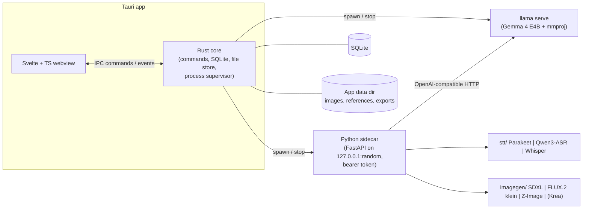
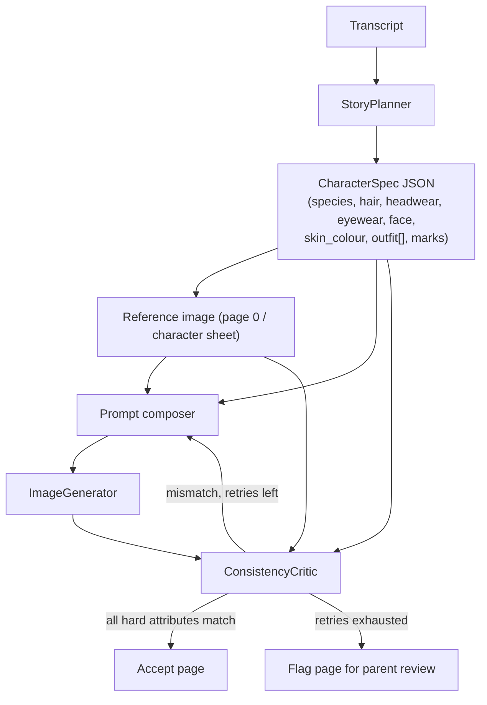
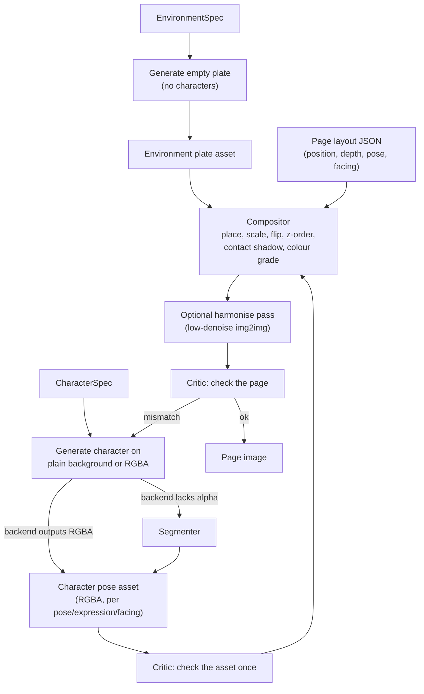

# Architecture

## 1. Goals and constraints

- A parent speaks a story; the app returns a 4–6 page illustrated book with consistent characters.
- **Fully local.** No accounts, no cloud calls at runtime. Audio never leaves the machine and is deleted after transcription.
- Target machine: 8 GB VRAM, 16 GB RAM. Only one heavy model is resident at a time.
- Each stage is a separate module with a simple input and output, so models and the UI framework can be swapped (brief, "Notes for Claude Code").

## 2. Process view



| Process | Responsibility | Why separate |
|---|---|---|
| **Svelte webview** | All UI, recording via `MediaRecorder`, page reader | Pure presentation; no model code |
| **Rust core** | IPC commands, SQLite, file store, supervises child processes, owns the job queue and the GPU/RAM scheduler | Single source of truth for state; survives sidecar crashes |
| **Python sidecar** | STT, image generation, safety checks, export. Exposes a local HTTP API with SSE progress | Python has the model ecosystem (diffusers, NeMo, transformers) |
| **`llama serve`** | Story planning and the vision consistency critic through one multimodal model | Separate process lets Rust kill it to free VRAM instantly |

The sidecar binds to `127.0.0.1` on a random port and requires a per-launch bearer token passed by the core. If the sidecar dies the core restarts it and resumes the job from the last completed page.

## 3. Pipeline

```mermaid
sequenceDiagram
  participant P as Parent
  participant UI as Svelte UI
  participant C as Rust core
  participant S as Python sidecar
  participant L as llama serve (Gemma)
  P->>UI: record story
  UI->>C: audio bytes
  C->>S: POST /stt/transcribe
  S-->>C: Transcript (audio deleted)
  opt text check enabled (setting, off by default)
    C->>S: POST /safety/text
  end
  C->>L: plan (transcript → specs + pages)
  L-->>C: StoryPlan JSON
  UI->>P: review transcript + page plan (editable)
  loop each environment and each (character, pose) needed
    C->>S: POST /assets/generate (spec, variant, seed; derived poses use /images/edit on the reference)
    S-->>C: environment plate / RGBA character cutout (cached)
  end
  C->>L: critique character assets (once per asset)
  L-->>C: ImageCheck JSON
  loop each page
    alt render_mode = layered
      C->>S: POST /compose (layout, assets)
      S-->>C: flattened page (+ optional harmonise pass)
    else render_mode = ref_compose
      C->>S: POST /images/edit (plate + character references + instruction)
      S-->>C: page image
    else render_mode = full_scene or composite_refine
      C->>S: POST /images/generate (prompt, refs, plate)
      S-->>C: page image
    end
    C->>L: critique page (image, specs, reference)
    L-->>C: ImageCheck JSON
    opt mismatch and retries left
      C->>S: regenerate asset or page (new seed / stronger refs)
    end
    C->>S: POST /safety/image
  end
  UI->>P: show book, allow export
```

Layered rendering and the asset cache are described in [section 5.1](#51-layered-rendering).

### Stages as modules

| Module | Input | Output | Default backend | Alternatives |
|---|---|---|---|---|
| `SpeechToText` | audio (16 kHz mono PCM) + language | `Transcript` (text, segments, timings) | Parakeet TDT 0.6B v3 | Qwen3-ASR 1.7B, Whisper large-v3-turbo, Gemma audio |
| `StoryPlanner` | `Transcript`, page count (4–6), `StyleProfile` | `StoryPlan` JSON built in several constrained calls (characters, environments, one call per page): `CharacterSpec[]`, `EnvironmentSpec[]`, pages[sentence range, scenario, effects, camera, environment, render_mode, layout[]]; code then fills `story_text`, `inferred_fields` and fixes `render_mode` (grammar-constrained, section 12) | Gemma 4 E4B via llama server | Gemma 4 E2B |
| `PromptComposer` (pure code) | specs + page scenario + style | final image prompt + negative prompt | deterministic templates | — |
| `ImageGenerator` (`generate`, and `edit` when the backend supports it) | prompt or edit instruction, `StyleProfile`, 1–4 reference images, seed, optional alpha/plate | PNG (RGBA via segmenter for character assets) + generation params | SDXL + IP-Adapter/LoRA (no `edit`) or FLUX.2 klein 4B (`generate` + `edit` + multi-reference; leading candidate) | Z-Image-Turbo, Krea 2 Turbo |
| `Segmenter` | image with plain background | RGBA cutout | BiRefNet (licence **verify**) | RMBG-2.0 (non-commercial), rembg with an explicit model; not needed for backends that output RGBA |
| `Compositor` (pure code, CPU) | environment plate, character cutouts, layout | flattened page PNG + layer metadata | PIL/numpy | — |
| `ConsistencyCritic` | asset or page image, specs, reference image | `ImageCheck[]` (per field match + confidence) | Gemma 4 E4B + mmproj, 1120 image tokens, thinking off | Gemma 4 E2B (low-VRAM fallback; 91.8% vs 94.7% accuracy) |
| `Safety` | image (always available); text (optional) | verdict + reasons | NSFW image classifier; text check is a minimal optional blocklist, **off by default** | — |
| `Exporter` | `Book` | PDF or PNG set | ReportLab/WeasyPrint (verify) | — |
| `MusicGenerator` | story mood, duration | audio file | not in v1 | ACE-Step 1.5 |

Interfaces are specified in [class.md](class.md).

## 4. Model lifecycle and memory budget

Only one heavy model is resident at a time. The Rust core owns a **ResourceScheduler** that serialises model loads and unloads.

| Phase | Resident | Approx. VRAM | Approx. RAM |
|---|---|---|---|
| Transcribe | STT model | 1–5 GB (**verify**) | <2 GB |
| Plan / critique | llama serve: Gemma 4 E4B + projector, 1120 image tokens (measured **4.5 GB VRAM**, 2.9 GiB RAM); E2B fallback 3.1 GB | 4.5 GB | ≈3 GB |
| Generate assets / pages | Image model only (llama stopped). **Measured: FLUX.2 klein 4B, community NF4 bundle, whole pipeline on the GPU:** 4.5 GiB weights, 6.9 GiB PyTorch peak, 7.8 GB board peak at 1024² (5.85 GiB / 7.1 GB at 768²) | ≈7.8 GB at 1024² (≈350 MiB spare), ≈7.1 GB at 768² | 3.7 GiB. Official bf16 weights, SDXL and Z-Image: not yet measured |
| Segment (if needed) | Segmenter (BiRefNet ≈1 GB weights) | <2 GB, or CPU | <2 GB |
| Compose | Compositor (no model) | 0 | <1 GB |
| Critique | llama serve again (GPU), or CPU (`-ngl 0`) while the image model stays loaded | ≈3.6 GB or 0 | ≈4 GB if on CPU |

Rules:

1. A `Job` requests a model from the scheduler; the scheduler unloads whatever else is resident first.
2. Image generation is batched per book (all pages in one load) to avoid repeated model loads; the critic then runs over all pages, and failed pages are regenerated in a second pass.
3. Each backend reports measured peak VRAM/RAM, so the UI can warn before a model that does not fit is selected.
4. `llama serve` is started on demand with an explicit `-ngl`, context size and `--mmproj`, and is stopped when idle.

## 5. Character consistency and layered rendering



- **Character spec ("bible").** Created once per book by the planner as uniform JSON (`CharacterSpec`: `species`, `hair`, `headwear`, `eyewear`, `face`, `skin_colour`, `outfit[]`, … see [class.md, section 3](class.md#3-structured-json-specs)). The planner fills the fields; it never writes prose descriptions of characters.
- **Deterministic prompts.** `PromptComposer` builds every image prompt in code: style prefix + camera + page `scenario` + `render_descriptor(spec)` for each present character + `render_environment(env)`. Because the descriptor is a pure function of the spec, a character reads identically on every page, and editing one field (say `headwear` to `fedora`) regenerates that character's text everywhere. `None` fields are dropped from the positive prompt and can add negative-prompt terms.
- **Environment spec.** Locations are also uniform JSON (`EnvironmentSpec`) and are reused by name across pages so the setting stays stable.
- **Reference image.** A character sheet is generated first and approved by the parent (or auto-approved if the critic passes). Later pages and new poses condition on it: **edit/multi-reference** on FLUX.2 klein (section 5.2), IP-Adapter for SDXL, img2img/LoRA for Z-Image.
- **Critic.** `build_checklist(spec)` generates one question per spec field, including absence checks for `None` fields. For each page the critic returns JSON `{field_path, expected, observed, match, confidence}` plus a "same character as reference?" verdict listing differences. Fields marked *hard* (species, hair, headwear, eyewear, skin colour, outfit item + colour) trigger regeneration; *soft* fields are only logged.
- **Retry policy.** For each failed hard field, in order: (1) a **targeted edit** built from the failed check ("change the robe colour from purple to deep blue, keep everything else the same") when the backend has the `edit` capability; (2) regeneration with a new seed; (3) stronger reference weight or a shorter prompt. At most N attempts in total (default 3). After that the page is kept with a warning flag for the parent. Backends without `edit` skip step 1.
- **Calibration.** The critic is tested against deliberately wrong images before it is trusted (roadmap Phase 0).

### 5.1 Layered rendering

Characters and environments are separate JSON specs, so they can also be separate **image assets** that are overlaid to build each page. Assets are generated once, cached, and reused.



**Render modes** (planner proposes, parent can override per page; `render_mode` is a grammar enum):

| Mode | Used for | How |
|---|---|---|
| `layered` (default for simple pages) | Characters standing, walking, waving in a scene; wide and medium shots | Compose cached assets; optional low-denoise harmonise pass (≈0.2–0.35, to be tuned) |
| `ref_compose` (needs a multi-reference edit backend) | Pages with several characters or effects where simple pasting looks wrong but identity must hold | Give the model the environment plate and each character's reference asset as input images, plus an instruction built from `scenario`, `layout` and `effects`; it places and blends them (section 5.2) |
| `composite_refine` | Pages where layering looks pasted but layout should be kept | Rough composite, then higher-denoise img2img or an edit instruction (≈0.45–0.6 on img2img backends) |
| `full_scene` | Interaction-heavy pages (sitting on a chair, hugging, holding objects, characters overlapping) or pages with `effects` | Normal generation conditioned on character references and the environment plate |

The default mix is decided after the Phase 0 comparison (roadmap 0.12). Pages whose `effects` list is non-empty are never `layered`.

**Producing RGBA assets**

- Image models generally return RGB. The default route is therefore **plain background + `Segmenter`**, applied to first generations and to edited (derived) assets.
- SDXL can also use LayerDiffuse for transparent first generations (transparent generation; SDXL supported; some features SD1.5-only and img2img support is reported inconsistently, **verify**), or generate on a plain background and segment.
- Z-Image-Turbo and others: plain background plus segmentation. Pick the segmenter model explicitly (BiRefNet handles hair well in single tests; rembg's default is weaker; RMBG-2.0 is CC BY-NC unless licensed from BRIA; BiRefNet's licence still has to be confirmed).

**Character pose set.** A character's first generation is the reference. From it the app derives a small sheet (front, side, walking, sitting, plus a few expressions) by **editing the reference** (section 5.2) when the backend supports `edit`, otherwise by conditioned generation (IP-Adapter). A page that needs an uncovered pose triggers one new asset derived from the reference, which then joins the cache. Derivation is always one hop from the reference: a derived asset is never edited again, because identity drifts with repeated edits.

**Layout.** For each present character the planner emits `{character, pose, expression, facing, position, depth}` from fixed enums (see [class.md](class.md#3-structured-json-specs)); an empty `layout` is valid for establishing shots. The `Compositor` turns these into coordinates and scale using the camera, depth and each character's `height_relative`/`build`, anchors feet on a ground line, flips for `facing`, draws a soft contact shadow, and nudges each layer's colour toward the environment palette and lighting. A crowd is the same cutout repeated and flipped.

**Asset cache and reuse**

- Key: hash of the relevant spec fields + pose + expression + facing + backend + style + seed. Changing a spec field (say `headwear`) invalidates that character's assets only.
- Environment plates are keyed by `EnvironmentSpec` + camera variant + time of day.
- Assets marked `reusable` enter the character/environment library and can be used in other books.
- The critic checks character fields once per asset instead of once per page; page-level checks cover layout, lighting and setting.

**Risks.** Pasted look (lighting, scale, shadows), poor handling of overlap and held objects, limited pose variety, cutout edge quality on hair and fur, and more assets to manage. The flat storybook style tolerates a cut-paper look better than photorealism would, which is why layering is plausible here.

### 5.2 Edit-model operations

An image-to-image / **edit** model takes one or more input images and a text instruction. FLUX.2 klein 4B (Apache-2.0) does text-to-image, single-reference editing and multi-reference editing (up to 4 images) with the same weights, so one backend can serve every operation below; SDXL can do the weaker img2img/IP-Adapter equivalents. Edit-capable backends advertise the `edit` capability ([class.md](class.md#2-module-interfaces)).

| Operation | Inputs | Instruction template (built in code from the specs) | Result |
|---|---|---|---|
| **Derive pose** | character reference asset | "Same character, now `<pose>`, with a `<expression>` expression, facing `<facing>`, plain light background. Keep the face, hair, outfit colours and proportions unchanged, **and keep `<accessory>` in the hand**." (The version without the accessory clause lost the stick in 4 of 5 edits; with it, 0 of 5. Measured, [research/image-bakeoff.md](research/image-bakeoff.md).) | new `character_pose` asset, `derived_from` = reference |
| **Derive environment variant** | environment plate | "Same place at `<time_of_day>` / `<weather>`, same layout and objects." | new `environment_plate` asset |
| **`ref_compose`** | plate + 1–3 character reference assets | "Place `<character A>` on the left in the foreground and `<character B>` on the right in the background in this scene. `<scenario>`. `<effects>`. Keep each character's appearance exactly as in its reference." | flattened page |
| **Harmonise** | composite from the `Compositor` | "Blend the characters into the scene with matching lighting and soft shadows. Do not change the characters." (alternative to low-denoise img2img; compared in spike 0.13) | page image |
| **Targeted repair** | failed asset or page + failed `ImageCheck`s | "Change `<field>` from `<observed>` to `<expected>`. Keep everything else exactly the same." | corrected asset/page; critic runs again |

Notes and risks

- Edits preserve identity better than independent generations, so most character fields should pass the critic on derived assets; the critic still checks them (once per asset).
- Edit models usually return RGB. Derived character assets are therefore requested on a plain background and then cut out by the `Segmenter`.
- Repeated edits drift. Always edit from the reference, never from an earlier edit; if a repair fails, regenerate instead of stacking edits.
- Step-distilled variants (4 steps) are fast but can follow instructions less reliably; the undistilled base variant may be needed for edits. Both are to be compared in spike 0.14.
- Licences differ per model: FLUX.2 klein 4B is Apache-2.0, the 9B variant is non-commercial. FLUX.1 Kontext [dev] (12B) is non-commercial and heavier, and Z-Image-Edit had not been released at the time of research, so neither is planned.
- All memory and speed numbers are third-party and unverified on the RTX A2000; one edit/generation model is resident at a time, as in section 4.

## 6. Safety and privacy

- **Audio:** held in memory or a temp file, deleted as soon as the transcript exists. Never stored in the DB or exported.
- **Network:** none at runtime. Model downloads happen only on explicit user action.
- **Text check (optional, off by default).** Setting `safety.text_check`. When enabled it runs a minimal blocklist (and, if configured, one constrained call to the planner model) on the transcript and plan text, and shows a warning banner on the Review screen. It never blocks or rewrites on its own; the parent decides. It is not part of the required pipeline.
- **Prompt hardening:** a fixed negative prompt and a picture-book style prefix are always applied; free text only reaches image prompts through the planner's structured output and the `PromptComposer`.
- **Image check (on by default).** An NSFW/violence classifier runs on generated assets and pages. Some community checkpoints and quantisations ship with no filter, so this is on by default; it can be disabled in settings with a warning **(confirm with the product owner)**. For unfiltered backends it is forced on.
- **Local data:** books are stored under the OS app-data directory; the parent can delete a book and all its files in one action.

## 7. Model management

- A **model registry** (`models` table + JSON manifest) lists name, role (`stt`, `llm`, `vlm`, `image`), path, size, sha256, licence and measured memory use.
- On startup the core scans `~/models` and the app model directory, matches files to manifest entries, and flags missing files.
- First-run check: GPU detection, free VRAM/RAM, `llama` binary location/version, and disk space. The result decides which backends the UI offers.
- Licences are shown in settings. Backends with non-commercial licences (for example Krea 2 Turbo's custom licence, FLUX.2 klein 9B, RMBG-2.0) are labelled **personal use only**.

## 8. Error handling

| Failure | Handling |
|---|---|
| Sidecar crash | Core restarts it; job resumes from the last persisted page |
| GPU OOM | Scheduler unloads all models, retries once with a lighter setting (lower resolution, CPU text encoder), then fails the page with a clear message |
| llama server fails to start (unsupported build) | Show detected version, link to the pinned install; offer to fall back to another planner backend |
| Invalid JSON from the LLM | Grammar/JSON-schema constrained decoding; on failure retry once with a repair prompt, then surface to the parent |
| Critic uncertain (confidence below threshold) | Treat as pass for soft attributes, flag for hard ones |
| Export failure | Keep the book; export can be retried |

Jobs are persisted in SQLite so cancel, retry and resume work after an app restart.

## 9. Python tooling: uv

The sidecar is a [uv](https://docs.astral.sh/uv/) project.

- `sidecar/pyproject.toml` declares dependencies; `uv.lock` is committed; `.python-version` pins the interpreter. Commands: `uv sync`, `uv run python -m sidecar`, `uv run pytest`, `uv add <pkg>`.
- **Python version:** the system Python is 3.14, but several ML packages lag behind new Python releases (torch publishes cp314 wheels per one source, but the CUDA index and dependencies such as NeMo may not). Let uv manage the interpreter (`uv python install 3.12`) and pin it, then bump after Phase 0 confirms every dependency has wheels **(verify)**.
- **PyTorch/CUDA:** add an `explicit = true` index for the matching CUDA build under `[[tool.uv.index]]` and route `torch`, `torchvision`, `torchaudio` to it in `[tool.uv.sources]`, per the [uv PyTorch guide](https://docs.astral.sh/uv/guides/integration/pytorch/). Check the driver's supported CUDA version first.
- **Dependency groups:** one optional group per backend (`stt-parakeet`, `stt-qwen3`, `image-sdxl`, `image-zimage`, …) so installing the app does not pull every model stack. Backends are discovered at runtime from what is installed.
- **Dev vs release:** during development Tauri runs the sidecar with `uv run`. For release, the first-run installer can create a venv with `uv sync --frozen` (uv is a single static binary and fast), which avoids a multi-GB PyInstaller bundle; see section 10.

**Built and verified (2026-10-11):** the sidecar's uv environment now contains the whole pipeline stack, in the dependency group `pipeline` (a default group; leave it out for light tests with `uv sync --no-group pipeline`). Pins: `torch==2.12.1` (the PyPI Linux wheel is the CUDA 13.0 build, `2.12.1+cu130`, so no extra index was needed), `diffusers==0.40.0`, `transformers==5.5.0`, `accelerate==1.15.0`, `bitsandbytes==0.50.2`, `safetensors==0.8.0`, `huggingface-hub==1.28.0`, `tokenizers==0.22.2`, `soundfile==0.14.0`, `numpy==2.5.2`, `pillow==12.3.0`, `pydantic==2.13.5`, `sentencepiece==0.2.2`. `uv sync` installed 59 packages (about 2 GB of downloads, `.venv` is 5.0 GB) on Python 3.14.6 with cp314 wheels. The stage scripts in `scripts/` run unchanged under this interpreter (`cd sidecar && uv run python ../scripts/run_all.py ...`); the stage runner of the app uses the sidecar's own `sys.executable`. Checks against the previous miniconda environment: the same page and seed renders **pixel-identical** (max difference 0; miniconda against itself also 0), 4 characters plus plate peak 6.90 GiB and 20 s, identical transcript, per-stage times within 10%, 23 script tests and 13 sidecar tests pass.

## 10. Repository layout (as built, 2026-10-11)

```
PictureBOOK/
├── Cargo.toml                 # Cargo workspace: crates/picturebook-core + src-tauri
├── package.json, svelte.config.js, vite.config.js, tsconfig.json
├── src/                       # SvelteKit static SPA (ssr off, adapter-static) shown in the Tauri window
│   ├── app.css                # muted theme tokens (docs/ui-design.md)
│   ├── lib/api.ts             # typed wrappers over Tauri commands and events
│   └── routes/                # +layout.svelte, +page.svelte (sidecar status, demo job); real screens come later
├── src-tauri/                 # Tauri 2 shell (thin): window, commands, event forwarding, owns the sidecar handle
│   ├── src/lib.rs, src/main.rs
│   ├── tauri.conf.json        # CSP restricted to self + ipc, window 1100x720 (min 900x600), dark background
│   └── capabilities/default.json   # core:default only
├── crates/picturebook-core/   # UI-free Rust core, tested without a GUI
│   ├── src/sidecar.rs         # spawn + token + ready line + HTTP client + SSE following + shutdown / kill on drop
│   ├── src/sse.rs             # incremental SSE parser
│   └── tests/sidecar_e2e.rs   # end-to-end tests against the real Python sidecar
├── sidecar/                   # Python (uv, Python 3.14 pinned) inference service
│   ├── picturebook_sidecar/   # app.py (auth, Host check, routes), jobs.py (SSE job manager), __main__.py (entry, watchdog)
│   └── tests/test_app.py
├── docs/, experiments/
└── (later) scripts/           # Phase 1 command-line pipeline prototypes
```

Planned additions inside `sidecar/picturebook_sidecar/`: `stt/`, `planner/`, `critic/`, `imagegen/`, `assets/`, `safety/`, `export/` (see section 3). The Rust core will also get the SQLite repositories, job queue and `ResourceScheduler`.

### Process contract (implemented and tested)

1. The core generates a random 32-byte token per launch and starts the sidecar with `PICTUREBOOK_TOKEN` in its environment and a piped stdin.
2. The sidecar binds `127.0.0.1` on a free port (refuses non-loopback hosts), then prints one JSON line `{"event":"ready","port":N,"pid":P}` to stdout.
3. Every request needs `Authorization: Bearer <token>` (constant-time comparison); a `Host` header outside loopback is rejected with 400 (DNS-rebinding defence); no CORS, no OpenAPI or docs routes; the HTTP client ignores system proxies.
4. **Parent death:** the core keeps the sidecar's stdin open; when the pipe closes (normal exit, crash or SIGKILL of the app) the sidecar shuts itself down within a fraction of a second. On a normal exit the core also calls `POST /shutdown`, and dropping the handle kills the process (`kill_on_drop`).
5. Long jobs stream progress over SSE (`progress`, `done`, `error`); late subscribers get the full history replayed. The core forwards events to the UI as the Tauri event `job-event`.

### Phase 2, thin slice: how it is built (2026-10-11)
- **Storage: the book folder is the only source of truth, there is no database and no index of paths.** `<data-dir>/books/<any name>/book.json` (`id`, `title`, `status`, `style`, `pages`, `source`, timestamps; unknown fields are kept) beside the pipeline's own files (`plan.json`, `pages/`, `regen_log.json`, `checks/report.json`, `book.pdf`). The library list is read by scanning the folders every time, so a folder the user renames, copies or deletes cannot leave a stale entry. A book is found by the id inside `book.json`; paths are always the folder plus a fixed relative name. Damaged cases are listed, not hidden: unreadable `book.json`, a copied folder with a duplicate id, a missing picture (placeholder + Redraw), an unusable plan. SQLite from [class.md](class.md) section 4 is **not used yet**; it can be added as a cache if scanning ever gets slow. Code: `crates/picturebook-core/src/books.rs` (13+1 tests including rename, move out and back, corrupt, duplicate, symlink and delete-safety cases).
- **The Rust core owns the books and the files; the sidecar only runs jobs on a book folder.** The sidecar refuses any folder that is not a direct child of the library folder (`PICTUREBOOK_LIBRARY`) or has no `book.json`, uses a fixed input name pattern (`story.txt` or `audio.<ext>`), allows **one pipeline job at a time** (one GPU; the second request gets 409 with the running job id) and kills whole process groups on cancel and shutdown.
- **Jobs reuse the Phase 1 scripts as one subprocess per job** (`scripts/run_all.py` for a book, `scripts/regen.py` for redraw and undo). The scripts print machine-readable lines `@@pb {"stage": ..., "state": "start|done|failed"}`; `sidecar/picturebook_sidecar/pipeline.py` turns them into SSE events (`progress {stage, label, fraction, message}`, then `done`, `error` or `cancelled`). The progress bar uses measured stage times as weights, only ever moves forward, and counts drawn pages. The stage processes keep their own memory-capped scopes, so one model is resident at a time exactly as measured; a redraw costs about 7 s of model load. Revisit a long-lived worker only if that hurts.
- **Pictures** are read through Tauri's asset protocol (scope: the library folder only) but shown from blob URLs made by `fetch` (`src/lib/images.ts`): an `` pointing at `asset://` failed in WebKitGTK while `fetch` worked. The same loader makes small covers and thumbnails and keys its cache by file version, so a redrawn page is never stale. Verified in the dev window and in the release-style build with the real CSP (`connect-src` includes `asset:`).
- **Computer notes belong to a picture.** `checks/hints.json` stores a signature (size and time) of the picture file each note was made for; the review shows a note only when it still matches, otherwise "not checked since this page was redrawn". A redraw re-checks its pages.
- **Shutdown safety (measured):** killing the app with SIGKILL during a generation left no process behind within 8 seconds (sidecar, `run_all`, stage and `llama serve` gone, GPU 0 MiB).

### Phase 2, second milestone (2026-10-11): first-run check and the characters approval flow
- **First-run check.** `GET /diagnostics` in the sidecar (`diagnostics.py`) lists ten checks (graphics card, PyTorch with CUDA, llama, Gemma, klein, Whisper, ffmpeg, memory limits through systemd, disk, memory), each `ok`, `warn` or `missing` with a plain fix. Model locations come from `scripts/modelpaths.py`, which the stage scripts also load models from, so the check cannot disagree with the pipeline (a test fails if a script names a model location itself again). Blocking = `missing` for anything the pipeline needs; a missing Whisper only blocks audio books. The app opens the Setup screen by itself once per session when something blocks; Settings links to it. It reads the machine, it never downloads or changes anything. Verified in the window against the real machine (all ok) and against an empty models folder and empty Hugging Face cache (3 blockers listed with the exact download command and size).
- **Three pipeline steps.** `run_all.py --steps plan|assets|pages|all` (`all` is the old one-go behaviour). `plan` = read the story and plan (the transcription is skipped when `transcript.json` exists), `assets` = draw characters and places and check them, `pages` = draw the pages, check, hints, PDF, review sheet. `assets.py --only "<name>"` draws one character or place again with new seeds (`assets/draw_log.json` counts the drawings, `rules.draw_seed`), after deleting only that item's pictures (`rules.asset_files`).
- **Book status `planned`** = the plan exists and waits for the parent's OK. `jobs.rs`: plan done -> planned, assets any outcome -> planned, pages done -> review (a failed or cancelled page step returns to planned), one-go generation unchanged. Setting `approve_first` (default on) makes "Make the book" run only the plan step.
- **Editing the plan.** `POST /plan/character` and `/plan/place` validate with the pipeline's own pydantic models (`scripts/schemas.py` loaded by path: enums, lengths and field names cannot drift), write `plan.json` atomically, drop exactly that item's pictures and its check entry, and remove the edited fields from `inferred_fields` ("the app guessed this" disappears once the parent typed it). Refused with a plain reason for: unknown fields (name, pages, layout are never editable), bad values, an unknown character, while a job runs, once any page picture exists, with no plan. `GET /plan/options` serves the drop-down values from the models.
- **Verified end to end in the window:** type a story -> plan only -> characters screen opens by itself and the planner's title is adopted -> change the hair colour -> save -> "draw characters and places" -> the new picture shows black braided hair -> "Draw again" for one character (25 s, other items untouched) -> "Looks good: draw the pages" -> review. SIGKILL of the app during the characters job leaves no process and 0 MiB VRAM.

### Recording a story (2026-10-11)
- **Spike result:** the webview (WebKitGTK 2.54, origin `tauri://localhost`, secure context) has `getUserMedia`, `MediaRecorder` and `AudioWorklet`, but a request **hangs forever** until the shell answers WebKit's permission request. Fix: `Builder::on_permission_request` in `src-tauri/src/lib.rs` allows the microphone and **denies everything else** (camera, location, screen capture, notifications). With it the request is granted in about 28 ms. Decision: record in the webview (no Rust capture module).
- **Pipeline of a recording:** `getUserMedia` -> `AudioWorklet` (`static/recorder-worklet.js`, loaded from `'self'`, so the CSP needs no `blob:` script) averages the device rate down to **16 kHz mono 16-bit** (exact area average, which is also the low-pass) and posts quarter-second chunks plus a level every 46 ms -> `src/lib/recorder.ts` keeps them in memory -> `src/lib/wav.ts` encodes the WAV -> Rust command `create_book_from_recording` receives the raw bytes as the request body (title, style, pages in headers), validates with `picturebook_core::audio::validate_wav` **before** a folder is made and stores `audio.wav`. The CSP gained `media-src 'self' blob:` for the playback player.
- **Validation (`audio.rs`):** RIFF/WAVE chunk walk, PCM, mono, 16-bit, 8-48 kHz, 1 s to 15 minutes, at most 64 MB; every truncation and damaged header is an error, never a panic.
- **Imported files** are converted with ffmpeg to the same 16 kHz mono WAV (no shell, `-t 900`, a 180 s time limit, output validated, no half-made output left) so the pipeline only ever sees checked audio. A missing ffmpeg gives a plain message.
- **Privacy:** after the transcript exists, `run_all.py` deletes the book's `audio.<ext>` (`rules.delete_recordings`: only with a non-empty transcript, never follows symlinks, only files directly in the book folder) unless the setting `keep_recordings` (default off) passed `--keep-audio`.
- **Limit found:** setting `PULSE_SOURCE` or `PIPEWIRE_NODE` for the app does **not** redirect WebKit's microphone stream (it always attached to the default input), and a stream cannot be moved with `pactl`. So the recording screen was verified up to the finished recording with the real microphone only (see the verification log); the rest of the path (bytes -> validation -> book -> Whisper -> plan -> deletion) was verified with a prepared speech file sent through the same command.

## 11. Packaging

- Linux first (AppImage / `.deb` via Tauri). Windows later.
- Two options for the sidecar, to be decided after Phase 0: (a) PyInstaller `externalBin` (self-contained, but torch/CUDA make it multi-GB), or (b) ship `uv` plus the lockfile and create the venv on first run (small installer, needs network once). uv makes (b) practical, and it is the leading option.
- Model weights are never bundled.

## 12. Structured output (JSON from the LLM)

Requirement: the planner and critic must always return JSON that matches the specs in [class.md, section 3](class.md#3-structured-json-specs).

| Option | How | Pros | Cons |
|---|---|---|---|
| **A. llama-server native (default)** | Send `response_format: {"type":"json_schema", "json_schema": {...}}` (or a raw `grammar` field with GBNF) to `llama serve`. The schema comes from the pydantic models. llama.cpp compiles it to a GBNF grammar and masks invalid tokens during sampling. | No extra Python runtime, works with the same process that serves Gemma + mmproj, schema stays in sync with pydantic | Schema keyword coverage is partial (unsupported keywords are ignored), so always re-validate with pydantic; external `$ref` needs flattening or the `json_schema_to_grammar` script |
| **B. Hand-written GBNF** | `.gbnf` files in `sidecar/planner/grammars/` | Full control, e.g. inject the character names as an enum for the page step | Must be kept in sync with the pydantic models; generate from schema where possible |
| **C. `guidance` package** | `guidance` with its llama.cpp backend (`guidance[llama_cpp]`), which uses llguidance | Pythonic control flow, interleaves free text and constrained fields, fast grammar engine | Its llama.cpp backend loads the model **in-process** (via llama-cpp-python), not from `llama serve`, so it would mean a second inference runtime and a second copy of Gemma in memory. Multimodal (Gemma 4 + mmproj) and the `gemma4` / `spark2_5` architectures depend on llama-cpp-python's bundled llama.cpp version **(verify)** |
| **D. `llguidance` directly** (PyPI `llguidance` 1.9.1, MIT) or llama.cpp built with `-DLLAMA_LLGUIDANCE=ON` | The Rust constrained-decoding engine used inside `guidance`, also integrated in llama.cpp, vLLM, SGLang and mistral.rs. Supports a large subset of JSON Schema, regex and Lark-style grammars; about 50 µs of CPU per token, typical JSON-schema mask about 1.5 ms. Wheels exist for CPython 3.14. | Fast and well maintained (guidance-ai organisation, frequent releases); broader grammar support than native GBNF | It is a library driven from a sampling loop (tokenizer + token prefix → token mask), so it only helps if we run the model in-process or rebuild llama.cpp from source (needs Rust; the installed `llama` 0.4.1-dev shows no sign of it in `--help` or `llama licenses`). **Verdict: not needed now.** Native `response_format` handled the full nested plan schema at about 79 tok/s vs about 93 tok/s unconstrained. Revisit only if native GBNF ignores or rejects schema keywords we need, slows down on bigger schemas, or inference moves in-process. |

Decision: **start with A** (pydantic → JSON Schema → `response_format`), with B only where the schema cannot express a constraint, and keep C as a spike (roadmap 0.8). Before relying on A, confirm on the installed `llama` build that `response_format` works together with `--mmproj` and an image in the request; the documentation does not say, but the grammar acts on the text sampler so it should **(verify)**.

Grammar-constrained output guarantees syntax, not meaning. The system prompt must still describe each field, planning runs as several calls (characters, then environments, then one call per page with the known names injected as enums), pydantic validates cross-references afterwards, and code computes everything that can be computed (see [class.md, section 3](class.md#what-code-decides-instead-of-the-llm)).

### Findings from the first live tests

Run on this machine with Gemma 4 E2B and E4B on `llama serve` 0.4.1-dev (details in [research/verification-log.md](research/verification-log.md)):

1. **Structured output works with thinking on, but thinking must be capped and rarely pays off.** Gemma 4 thinks by default and emits `reasoning_content` before the answer. With `--reasoning-budget 2048` and `max_tokens` 8192 every structured call finished with valid JSON (180+ calls tested), and a budget exhausted on purpose (64 tokens) is cut off cleanly and still yields valid JSON. Without a budget the thought can use the whole token limit and leave `content` empty, which is what the first (small `max_tokens`) tests saw. Measured benefit is small: the critic was not more accurate with thinking (mismatch recall 79.5% vs 88.5%) at 2.8× the latency, and in planning thinking cost 2.7× more time for a small gain, so **thinking is off by default** (`"chat_template_kwargs": {"enable_thinking": false}` per request) with `--reasoning-budget 2048` always set on the server. See [research/thinking-and-planner-tests.md](research/thinking-and-planner-tests.md).
2. **Bound everything.** Give every string `maxLength`, every array `maxItems`, and use enums for open lists. An unbounded array of free strings ran to the token limit and produced truncated JSON.
3. **`response_format` works together with `--mmproj` and an image** (critic call), and nested schemas with `$defs`/`$ref` (the full plan schema, about 5 KB) are accepted.
4. **Syntax is guaranteed, semantics are not.** Cross-references, rules like "effects ⇒ not layered", sentence fidelity and "what did the speaker not say" must be enforced or computed in code.
5. **Confidence from token probabilities must be renormalised.** `logprobs` are reported before grammar masking, so use `p(true) / (p(true) + p(false))` over the allowed tokens.
6. **Server hygiene.** `llama serve` starts with open CORS and no key. The supervisor must bind to `127.0.0.1`, set `--api-key`, and pass the key to the sidecar.
7. **Latency and memory:** Gemma 4 E2B (`-ngl 99 -c 8192`) about 2.7 GB VRAM and about 93 tokens/s; with a 1120-token image budget 3.1 GB. **Gemma 4 E4B with the projector and a 1120-token image budget: 4.5 GB VRAM, about 2.9 GiB resident RAM, about 5.8 s per critic call** (E2B about 3.6 s). One 512 px image costs about 140 prompt tokens at the default budget and about 1,100 with `--image-min-tokens 1120 --image-max-tokens 1120`.
8. **The vision token budget is the most important critic setting.** Raising it from the default to 1120 improved the critic from 88% to 92% (E2B) and from 88% to 94.7% (E4B) accuracy; E4B at default tokens was no better than E2B. Always start the vision server with `--image-min-tokens 1120 --image-max-tokens 1120` ([research/critic-evaluation.md](research/critic-evaluation.md)).
9. **The model ignores rules the grammar cannot express** (in every planner configuration at least one rule was broken per plan, for example `effects` on most pages with `render_mode` left at `layered`), so rule enforcement is code, not prompting.

### Design rules from constrained-decoding practice

From Aidan Cooper's [Structured generation with constrained decoding](https://www.aidancooper.co.uk/constrained-decoding/) (April 2024; it covers SGLang, Outlines, guidance and llama.cpp GBNF, not llguidance, XGrammar or Gemma 4 with `--mmproj`):

1. **Local models only.** Constraining needs the full next-token distribution, which suits our local-only design.
2. **Field order matters.** The model writes fields in schema order and cannot go back. Put identity and context first and free-text reasoning before decisions: `scenario` before `camera`/`layout`, `observed` before `match` in `ImageCheck`, `reasons` before `allowed` in any verdict.
3. **Natural names and values.** Use descriptive keys and ordinary words for enum values. Forcing unnatural or lowercase/uppercase-mismatched choices degrades answers (the article's "France" vs "spain" example).
4. **Enums over open patterns.** Prefer closed choice lists (`age_group`, `camera`, `pose`, `render_mode`) to regexes; greedy first-token commitment can lock in a wrong answer.
5. **Placeholders are cheap.** Keep every key present with `"None"` rather than optional keys; fixed scaffolding is not generated, so it costs almost nothing.
6. **Bound arrays.** Give `outfit`, `key_objects`, `layout` and `characters` `minItems`/`maxItems`; for open-ended lists use a continue-or-stop step instead.
7. **Nested schemas need a test.** The article reports a nested-model conversion bug in Outlines. Our path (pydantic to JSON Schema to llama.cpp) is different, but a test must round-trip nested `outfit[]` and `layout[]` through `llama serve` and validate the result.
8. **Use logprobs.** Token log-probabilities show where a forced value was low-confidence; feed this into the critic's `confidence` and into planner debugging.
9. **Interleaved generation** (fixed scaffolding with small constrained generations) is a valid alternative to one large schema and is compared in spike 0.8.

Sources: [llama.cpp server / structured output](https://www.mintlify.com/ggml-org/llama.cpp/api/tools/llama-server) · [llama.cpp multimodal](https://www.mintlify.com/ggml-org/llama.cpp/inference/multimodal) · [llama.cpp llguidance notes](https://huggingface.co/OpenTransformer/llama.cpp-prismml/blob/main/docs/llguidance.md) · [Liquid AI: structured output with llama.cpp](https://docs.liquid.ai/deployment/on-device/llama-cpp/structured-output)
