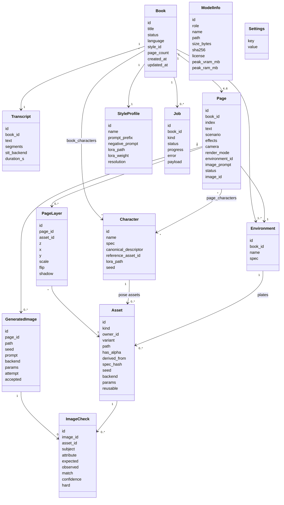
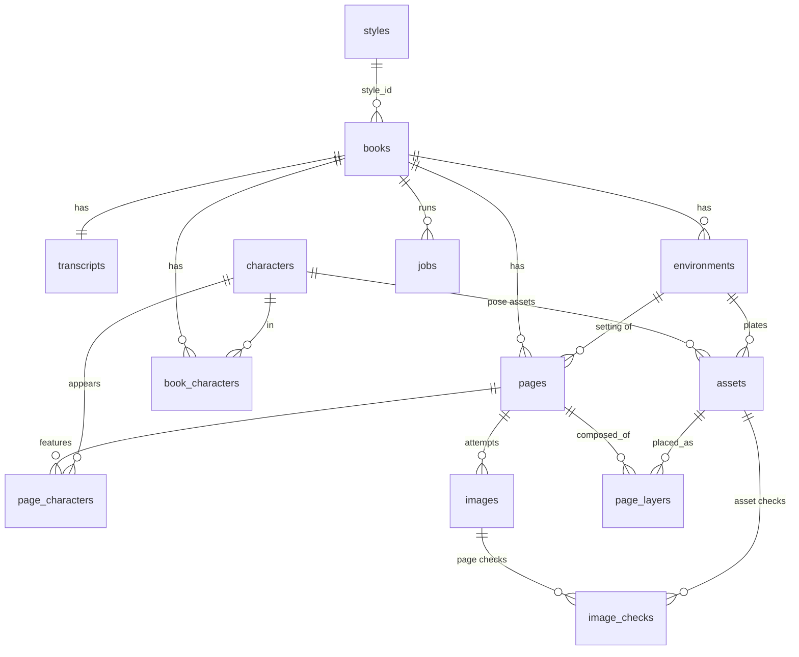

# Classes, interfaces and database design

Types are written once in the language-neutral notation below and mirrored as Rust structs (core), TypeScript types (UI) and pydantic models (sidecar). IDs are UUIDv7 strings; timestamps are ISO-8601 UTC.

## 1. Domain model



### Key entities

**Book.** `status`: `draft` → `transcribed` → `planned` → `generating` → `review` → `complete` | `failed`. `language` is `en` in v1.

**Character.** `spec` is a `CharacterSpec` (uniform JSON, section 3). `canonical_descriptor` is **derived** from `spec` by a deterministic function `render_descriptor(spec)` and cached; the LLM never writes it, so the same character always produces the same prompt text. The critic checklist is also derived from `spec` (one check per field).

**Environment.** A reusable location per book (`EnvironmentSpec`, section 3). Pages in the same place reference the same environment row so the setting does not drift between pages.

**Page.** `scenario` is a short free-text description of what is happening on that page (action, emotion, who does what); `camera` is a shot type (`wide`, `medium`, `close-up`). `effects` lists non-character, non-setting elements (magic, weather effects). `render_mode` is `layered`, `ref_compose`, `composite_refine` or `full_scene` (see [architecture.md, section 5.1](architecture.md#51-layered-rendering)). The page's `image_prompt` is **composed by code** from style prefix + scenario + character descriptors + environment, not written freehand by the LLM; it is used by `full_scene` and `composite_refine` and by the optional harmonise pass.

**Asset.** A reusable image artifact: either a `character_pose` (RGBA cutout for one character in one pose, expression and facing) or an `environment_plate` (empty background). `variant` holds `{pose, expression, facing}` or `{camera, time_of_day}`; `derived_from` is the id of the reference asset this one was produced from by an edit (null for first generations; derivation is always one hop from the reference, never an edit of an edit); `spec_hash` is a hash of the spec fields that influence the look plus pose, backend, style and seed, and is the cache key. Assets marked `reusable` form the character/environment library across books. A character's reference image is its first approved `character_pose` asset (`characters.reference_asset_id`).

**PageLayer.** One placed asset on a layered page: `z` order, `x`/`y` (normalised 0–1 anchor of the feet or plate origin), `scale`, `flip`, and `shadow` parameters. Computed by the `Compositor` from the page layout JSON; stored so a page can be re-composed or hand-adjusted without regenerating anything.

**GeneratedImage.** The final flattened page (or a `full_scene` generation). Stores everything required to reproduce it (`seed`, `prompt`, `backend`, `params`: steps, cfg, resolution, LoRA, reference strength, harmonise denoise). A page may have several images (attempts); exactly one has `accepted = 1`.

**ImageCheck.** One row per field per target per critic run; the target is either a page image or an asset. A page is accepted when all `hard` rows have `match = 1` with `confidence >= threshold`. Character fields are verified once per asset; page checks cover layout, lighting and setting.

## 2. Module interfaces

Written in Python (sidecar) with equivalent TypeScript/Rust definitions generated from JSON Schema.

```python
class SpeechToText(Protocol):
    name: str
    def load(self) -> None: ...
    def unload(self) -> None: ...
    def transcribe(self, audio: AudioBuffer, language: str = "en") -> Transcript: ...
    # AudioBuffer: 16 kHz mono float32 samples. Transcript: text + segments[{start,end,text}].

class StoryPlanner(Protocol):
    def plan(self, transcript: Transcript, pages: int, style: StyleProfile,
             existing_characters: list[Character] | None = None) -> StoryPlan: ...
    # StoryPlan: title, characters[CharacterSpec], environments[EnvironmentSpec],
    #            pages[{index, story_text, scenario, effects[], camera, environment, render_mode, layout[]}]
    # Output is grammar-constrained to the JSON in section 3. The planner returns no image_prompt;
    # PromptComposer builds it from the specs (see architecture.md, section 5).

class ImageGenerator(Protocol):
    name: str
    capabilities: set[Literal["ip_adapter", "lora", "multi_reference", "img2img", "edit", "rgba"]]
    def load(self) -> None: ...
    def unload(self) -> None: ...
    def generate(self, req: ImageRequest) -> ImageResult: ...
    # ImageRequest: prompt, negative_prompt, style, references[ImageRef], seed, width, height, steps, cfg,
    #               alpha: bool (ask for RGBA if "rgba" in capabilities, else plain background),
    #               init_image/denoise (for harmonise and composite_refine passes on img2img backends)
    # ImageResult: png_bytes, seed, params, peak_vram_mb, seconds
    def edit(self, req: ImageEditRequest) -> ImageResult: ...      # only if "edit" in capabilities
    # ImageEditRequest: instruction (text), references[ImageRef] (1..4; first is the image to edit),
    #                   seed, strength (how far the edit may deviate), mask (optional), width, height
    # Used for: pose/expression derivation, environment variants, ref_compose, harmonise, targeted repair.
    # Backends without "edit" (e.g. plain SDXL) fall back to IP-Adapter conditioning or low-denoise img2img.

class Segmenter(Protocol):                       # only used when a backend cannot output RGBA
    def cutout(self, image: bytes) -> bytes: ...  # returns RGBA PNG; edge/hair quality tested in spike 0.11

class AssetService(Protocol):                    # cache in front of ImageGenerator + Segmenter
    def get_or_create_character_asset(self, character: Character, variant: PoseVariant,
                                      seed: int | None = None) -> Asset: ...
    def get_or_create_environment_plate(self, env: Environment, variant: PlateVariant,
                                        seed: int | None = None) -> Asset: ...
    def derive_character_asset(self, reference: Asset, variant: PoseVariant,
                               seed: int | None = None) -> Asset: ...
    # Produces a new pose/expression/facing by editing the character's reference asset (one hop only).
    # Instruction template: "Same character, now <pose>, <expression>, facing <facing>, plain background;
    #                        keep the face, hair, outfit colours and proportions unchanged."
    def derive_environment_variant(self, plate: Asset, variant: PlateVariant,
                                   seed: int | None = None) -> Asset: ...
    # e.g. "Same place at night, same layout." Falls back to normal generation if no edit capability.
    def repair(self, target: Asset | GeneratedImage, failed: list[ImageCheck]) -> RepairInstruction: ...
    # Builds an edit instruction from failed hard checks, e.g.
    # "Change the robe colour from purple to deep blue. Keep everything else exactly the same."
    # Cache key = Asset.spec_hash; spec edits invalidate only affected assets.

class Compositor(Protocol):                      # pure CPU code, no model
    def layout(self, page: Page, assets: dict[str, Asset]) -> list[PageLayer]: ...
    def compose(self, plate: Asset, layers: list[PageLayer], palette: list[str]) -> bytes: ...
    # Places cutouts using camera + depth, flips for facing, adds contact shadow, colour-grades toward palette.
    # Cutout scale uses each character's height_relative (and build) so a "short" prince stands visibly
    # shorter than an "average" mage; the page's camera and depth then scale everyone together.

class ConsistencyCritic(Protocol):
    def check_asset(self, image: bytes, character: Character,
                    reference: bytes | None) -> list[ImageCheck]: ...
    def check_page(self, image: bytes, page: Page, characters: list[Character],
                   environment: Environment) -> list[ImageCheck]: ...
    def same_character(self, image: bytes, reference: bytes) -> SameCharacterVerdict: ...
    # Output is JSON-schema constrained; temperature 0; thinking off. Field order in the output schema: attribute,
    # expected, observed, match. `confidence` is not generated: it is computed from the token probabilities of the
    # `match` answer, renormalised over {true, false}.
    # Server settings that matter (measured): Gemma 4 E4B + projector, `--image-min-tokens 1120 --image-max-tokens 1120`.
    # Policy: a mismatch is auto-acted on only when confidence >= 0.99; lower-confidence answers go to the
    # reference-comparison check (`same_character`) or to the parent. Measured: 94% recall, 6% false alarms
    # at that threshold (research/critic-evaluation.md).

class Safety(Protocol):
    def check_image(self, image: bytes) -> SafetyVerdict: ...      # on by default
    def check_text(self, text: str) -> SafetyVerdict: ...          # optional, setting safety.text_check, off by default
    # SafetyVerdict (fields in this order): reasons: list[str], categories: list[str], allowed: bool.
    # check_text is a minimal blocklist (+ optional constrained call to the planner model); it warns, never blocks or rewrites.

class Exporter(Protocol):
    def export(self, book: BookExport, fmt: Literal["pdf", "png"], dest: Path) -> Path: ...

class MusicGenerator(Protocol):          # not implemented in v1
    def generate(self, mood: str, seconds: int) -> bytes: ...
```

### Rust core services

| Service | Responsibility |
|---|---|
| `BookRepository` | CRUD over SQLite; owns migrations |
| `JobQueue` | Persist, run, cancel, resume jobs; emits `job-progress` events to the UI |
| `ResourceScheduler` | Serialises model loads; decides when to stop/start llama and the sidecar models |
| `Supervisor` | Spawns/monitors the sidecar and `llama serve`; health checks; token management |
| `ModelRegistry` | Scans model directories, matches the manifest, stores measured memory use |
| `FileStore` | App-data paths for images, references, exports; delete-book cleanup |

### UI stores (Svelte)

`books`, `currentBook`, `jobs` (progress stream), `models`, `settings`. The UI only talks to Rust commands and events, never directly to the sidecar.

## 3. Structured JSON specs

All LLM output is a fixed, uniform JSON shape. The **pydantic models in the sidecar are the single source of truth**; the JSON Schema (and from it the GBNF grammar) is generated from them, and the Rust/TS types are generated from the same schema. Every key is always present (no optional keys, no `null`); "nothing" is the explicit string `"None"`. That keeps the grammar simple and lets the critic always ask a question for every field.

### CharacterSpec

```json
{
  "name": "Little Red",
  "species": "human",
  "age_group": "child",
  "build": "average",
  "height_relative": "short",
  "hair": "brown, in a bun",
  "headwear": "red hood",
  "eyewear": "None",
  "face": "freckles",
  "skin_colour": "light",
  "outfit": [
    {"item": "cape", "colour": "red", "detail": "hooded, knee length"},
    {"item": "dress", "colour": "white", "detail": "None"},
    {"item": "boots", "colour": "brown", "detail": "None"}
  ],
  "accessories": "basket of cakes",
  "distinguishing_marks": "None",
  "inferred_fields": ["hair", "skin_colour", "face"]
}
```

| Field | Type | Allowed values | Critic treats as |
|---|---|---|---|
| `name` | string | any | not checked |
| `species` | string | free text, e.g. `human`, `fox`, `robot` | **hard** |
| `age_group` | enum | `infant`, `child`, `teen`, `adult`, `elderly`, `none` | soft |
| `build` | enum | `slight`, `average`, `sturdy`, `large` | **hard** |
| `height_relative` | enum | `very_short`, `short`, `average`, `tall` (relative to the other characters in the story) | **hard**; also drives cutout scale in the `Compositor` |
| `hair` | string | description or `None` (bald/no hair) | **soft** when checked by naming a colour (the critic is unreliable at that: 19–42% false alarms in [critic-evaluation.md](research/critic-evaluation.md)); **hard** only in reference-comparison mode |
| `headwear` | string | `None` or e.g. `fedora`, `red hood` | **hard** |
| `eyewear` | string | `None` or e.g. `round glasses` | **hard** |
| `face` | string | `None` or e.g. `freckles`, `acne`, `beard` | soft |
| `skin_colour` | string | free text (also fur/scale colour for non-humans) | **soft** by naming (untested, expected to behave like hair colour); hard in reference-comparison mode |
| `outfit` | array of `{item, colour, detail}` | at least one item; `detail` may be `None` | **hard** for `item` + `colour` |
| `accessories` | string | `None` or description | soft |
| `distinguishing_marks` | string | `None` or e.g. `scar over left eye` | soft |
| `inferred_fields` | array of field paths (enum of this spec's field names) | `[]` or e.g. `["hair", "outfit[0].colour"]`; **filled in by code** | not checked |

The first example in the discussion (`species`, `hair`, `headwear`, `eyewear`, `face`, `skin_colour`) is the core; `name`, `age_group`, `outfit`, `accessories` and `distinguishing_marks` were added because clothing colour is the most visible and most commonly drifting attribute (the red-hood-turns-blue case). `build` and `height_relative` were added after the [mock run](examples/mock-run.md) showed that a stated trait such as "small frame and stature" had no field. The hard/soft table lives in code, not in the JSON.

`inferred_fields` is always the last key. It lists the fields **the speaker did not state** and that the planner had to invent (the prince's hair colour, the mage's whole outfit). It is **computed by code, not written by the LLM**: a live test showed the small planner model under-reports what it invented (it listed `build` and `height_relative` but not the hair, skin and outfit it also made up), and free-text lists made it ramble until the token limit. The rule is deterministic: a field is inferred when none of its content words (colours, nouns) appear in the transcript, plus every field of a character or place that the transcript never mentions. The grammar therefore does not contain `inferred_fields`; code adds it after generation. The Review screen highlights those fields so the parent can confirm or change them; they are otherwise treated like any other field.

### EnvironmentSpec

```json
{
  "name": "Grandmother's cottage",
  "setting": "indoor",
  "location": "small wooden cottage, living room",
  "time_of_day": "evening",
  "weather": "None",
  "season": "autumn",
  "lighting": "warm firelight",
  "mood": "cosy",
  "palette": ["warm orange", "brown", "cream"],
  "key_objects": ["stone fireplace", "patchwork rug", "rocking chair"],
  "inferred_fields": ["time_of_day", "season", "palette"]
}
```

| Field | Type | Allowed values |
|---|---|---|
| `name` | string | unique within the book; pages refer to it |
| `setting` | enum | `indoor`, `outdoor` |
| `location` | string | free text |
| `time_of_day` | enum | `dawn`, `morning`, `noon`, `afternoon`, `evening`, `night`, `none` |
| `weather` | string | `None` or e.g. `light rain`, `snow` (outdoor) |
| `season` | enum | `spring`, `summer`, `autumn`, `winter`, `none` |
| `lighting` | string | free text |
| `mood` | string | free text, one or two words |
| `palette` | array of strings | 2–4 colours |
| `key_objects` | array of strings | 0–6 items; `[]` when none |
| `inferred_fields` | array of field paths (enum of this spec's field names) | `[]` or the fields that are not backed by the transcript; always the last key; **filled in by code**, not generated |

### Page scenario

```json
{
  "index": 3,
  "first_sentence": 5,
  "last_sentence": 5,
  "story_text": "Red walked into the cottage and saw a very strange grandmother.",
  "scenario": "Red stands in the doorway holding her basket, eyes wide, while the wolf in a nightcap sits up in the bed.",
  "effects": [],
  "camera": "medium",
  "environment": "Grandmother's cottage",
  "render_mode": "ref_compose",
  "layout": [
    {"character": "Little Red", "pose": "standing", "pose_detail": "holding a basket with both hands",
     "expression": "surprised", "facing": "right", "position": "left", "depth": "foreground"},
    {"character": "Wolf", "pose": "sitting", "pose_detail": "upright in bed, wearing a nightcap",
     "expression": "curious", "facing": "left", "position": "right", "depth": "mid"}
  ]
}
```

Fields are listed in generation order. `first_sentence`/`last_sentence` are the only text the planner writes about the story's own words; `story_text` is **copied by code** from those sentence indices. `scenario` is the only free-form description of the page: one or two sentences about the action and emotion, written before the structured decisions that depend on it. `environment` and each `layout[].character` must match names defined earlier in the plan (enforced by validation, and by the grammar once the names are known).

| Field | Allowed values |
|---|---|
| `effects` | 0–3 short strings for things that are neither a character nor the setting, e.g. `"spiral of water rising from the river"`, `"glowing lattice of light"`; `[]` when none. Always present. In the page call it is preceded by a gate field `has_effects` (boolean, asked first) because without a gate the planner filled `effects` on 80–93% of pages ("light flare"); when `has_effects` is false code writes `[]`. |
| `camera` | `wide`, `medium`, `close-up` |
| `render_mode` | `layered`, `ref_compose`, `composite_refine`, `full_scene` (the planner proposes; the parent can override per page). When `effects` is non-empty the planner must not choose `layered`, because effects are not part of any cutout or plate. |
| `layout` | 0–4 items; `[]` for establishing shots with no character. A character may appear twice (crowds); the same cutout is reused, flipped. |
| `layout[].pose` | `standing`, `walking`, `running`, `sitting`, `jumping`, `waving`, `pointing`, `sleeping`, `holding_item`, `hugging`, `other` (+ free-text `pose_detail`, `None` if not needed) |
| `layout[].expression` | `happy`, `sad`, `surprised`, `scared`, `angry`, `curious`, `sleepy`, `neutral`, `shy`, `proud`, `determined`, `embarrassed` |
| `layout[].facing` | `left`, `right`, `front`, `back` |
| `layout[].position` | `left`, `center`, `right` |
| `layout[].depth` | `foreground`, `mid`, `background` |

The `layout` entries drive the `Compositor` for `layered` pages, are given to the edit model for `ref_compose`, and are rendered into the prompt for the other modes. The enum lists are a first draft to be tuned in spike 0.9; each `(pose, expression, facing)` combination a story uses becomes one `Asset`, either generated or derived by editing the character's reference asset (see [architecture.md, section 5.2](architecture.md#52-edit-model-operations)). `effects` may later become a third asset kind; for now they are described in the prompt of the `ref_compose`, `composite_refine` or `full_scene` render.

### Full StoryPlan

```json
{
  "title": "string",
  "characters": [ CharacterSpec, ... ],
  "environments": [ EnvironmentSpec, ... ],
  "pages": [ PageScenario, ... ]
}
```

### How the JSON is produced

1. Source of truth: pydantic models (`sidecar/planner/schemas.py`).
2. `model_json_schema()` produces the JSON Schema; enums for `age_group`, `setting`, `time_of_day`, `season`, `camera`, `render_mode`, `pose`, `expression`, `facing`, `position`, `depth` come from Python `Literal` types. Arrays carry `minItems`/`maxItems`. Field order in the models is the generation order (see the design rules in [architecture.md, section 12](architecture.md#design-rules-from-constrained-decoding-practice)).
3. The schema is sent to `llama serve` as `response_format: {"type": "json_schema", ...}`; llama.cpp converts it to a **GBNF** grammar and constrains sampling, so the output always parses. (Alternative: hand-written `.gbnf` for tighter control, or the `guidance` package; see [architecture.md](architecture.md), section 12.)
4. The result is validated by pydantic again (cross-references, page count 4–6, page `environment` and `layout[].character` exist) and repaired or retried on failure.
5. Planning is **several grammar-constrained calls, not one**. Tests with the full nested schema in a single call parsed correctly every time (even with thinking on, within 8k tokens; see [research/thinking-and-planner-tests.md](research/thinking-and-planner-tests.md)), but the planner broke the rules the grammar cannot express in every configuration. The first single-call run (E2B, no thinking) defined one environment and then referenced three that did not exist, left `layout` empty on every page, put `effects` on every page, chose `layered` for pages that had effects, wrote a garbled `story_text`, and invented nonsense `inferred_fields`; later runs with thinking and with E4B were better but still broke at least one rule in almost every plan. The pipeline is therefore: (a) call 1: characters; (b) call 2: environments; (c) one call **per page**, with `environment` and `layout[].character` restricted to enums of the names from (a) and (b); (d) code fills or fixes everything that can be computed (below).

### What code decides instead of the LLM

| Field | How it is produced | Why |
|---|---|---|
| `story_text` | The planner outputs `first_sentence` and `last_sentence` (indices into the sentence-split transcript); code copies the text | Guarantees the book says what the parent said; the test showed paraphrased or truncated text |
| `inferred_fields` | Computed from the transcript (see above) | The model under-reports and rambles |
| `render_mode` | Code sets it; the planner's proposal is advisory: if `effects` is non-empty the mode is `ref_compose` (or `full_scene` if the backend has no `edit` capability), if `layout` is empty it is `layered`, otherwise `layered` unless the parent or a heuristic (characters overlapping, held objects) says otherwise | The model ignored this rule in every configuration tested: in one run all 42 pages that had effects were left at `layered` |
| `layout` presence | Code checks that every character named in the page's `scenario` or `story_text` appears in `layout` (and vice versa) and re-asks once if not | The model returned `[]` for pages that clearly had the prince |
| Page count | Code picks 4–6 from the transcript length (about one page per 1–3 sentences) and passes it in | Avoids the model deciding |

### Prompt composition and critic checks (derived from the specs)

- `render_descriptor(CharacterSpec) -> str` is deterministic, e.g. `Little Red, a short, average-build child human with brown hair in a bun, light skin, freckles, wearing a red hood, a red hooded knee-length cape, a white dress and brown boots, carrying a basket of cakes`. `build` and `height_relative` are rendered as adjectives (`small slight`, `tall sturdy`) and are also used by the `Compositor` for relative scale. Fields equal to `None` are omitted from the prompt (and may add terms to the negative prompt, e.g. `glasses` when `eyewear` is `None`).
- `render_environment(EnvironmentSpec) -> str` similarly.
- `PromptComposer` = style prefix + camera + scenario + descriptors of the characters in `layout` + environment. For character assets the prompt is style prefix + descriptor + pose + expression + facing + "plain background" (or alpha), with no scenario or environment; for environment plates it is style prefix + environment description + "no people, no characters".
- `build_checklist(CharacterSpec) -> list[Check]` creates one question per field with its `hard` flag, including **absence checks** ("is the character wearing glasses? expected: no"). The critic answers them in one schema-constrained call (section 2, `ConsistencyCritic`), and results are stored in `image_checks` with `attribute` such as `outfit[0].colour`. Output fields are ordered `field_path`, `expected`, `observed`, `match`, `confidence` so the model describes what it sees before deciding.
- Environment checks are lighter (setting, time of day, lighting, key objects visible) and all soft by default.

## 4. SQLite schema

**Not used in the thin slice (see [architecture.md](architecture.md), Phase 2): the book folders are the source of truth.** The schema below stays the design for the library/characters later. SQLite via `rusqlite`/`sqlx`; migrations in `src-tauri/src/db/migrations/NNNN_name.sql`. Foreign keys on; WAL mode.

```sql
CREATE TABLE styles (
  id            TEXT PRIMARY KEY,
  name          TEXT NOT NULL,
  prompt_prefix TEXT NOT NULL,
  negative_prompt TEXT NOT NULL DEFAULT '',
  lora_path     TEXT,
  lora_weight   REAL,
  width         INTEGER NOT NULL DEFAULT 1024,
  height        INTEGER NOT NULL DEFAULT 1024,
  is_builtin    INTEGER NOT NULL DEFAULT 0
);

CREATE TABLE books (
  id          TEXT PRIMARY KEY,
  title       TEXT NOT NULL,
  language    TEXT NOT NULL DEFAULT 'en',
  status      TEXT NOT NULL CHECK (status IN
              ('draft','transcribed','planned','generating','review','complete','failed')),
  style_id    TEXT NOT NULL REFERENCES styles(id),
  page_count  INTEGER NOT NULL CHECK (page_count BETWEEN 1 AND 12),
  created_at  TEXT NOT NULL,
  updated_at  TEXT NOT NULL
);

CREATE TABLE transcripts (
  id          TEXT PRIMARY KEY,
  book_id     TEXT NOT NULL UNIQUE REFERENCES books(id) ON DELETE CASCADE,
  text        TEXT NOT NULL,
  segments    TEXT NOT NULL,            -- JSON [{start,end,text}]
  stt_backend TEXT NOT NULL,
  duration_s  REAL
);                                      -- audio itself is never stored

CREATE TABLE characters (
  id                   TEXT PRIMARY KEY,
  name                 TEXT NOT NULL,
  spec                 TEXT NOT NULL,   -- JSON CharacterSpec (section 3)
  canonical_descriptor TEXT NOT NULL,   -- render_descriptor(spec), cached
  reference_asset_id   TEXT,            -- first approved character_pose asset (FK added after assets)
  lora_path            TEXT,
  seed                 INTEGER,
  is_reusable          INTEGER NOT NULL DEFAULT 0,   -- saved to the character library
  created_at           TEXT NOT NULL
);

CREATE TABLE book_characters (
  book_id      TEXT NOT NULL REFERENCES books(id) ON DELETE CASCADE,
  character_id TEXT NOT NULL REFERENCES characters(id) ON DELETE CASCADE,
  PRIMARY KEY (book_id, character_id)
);

CREATE TABLE environments (
  id      TEXT PRIMARY KEY,
  book_id TEXT NOT NULL REFERENCES books(id) ON DELETE CASCADE,
  name    TEXT NOT NULL,
  spec    TEXT NOT NULL,                -- JSON EnvironmentSpec (section 3)
  UNIQUE (book_id, name)
);

CREATE TABLE pages (
  id           TEXT PRIMARY KEY,
  book_id      TEXT NOT NULL REFERENCES books(id) ON DELETE CASCADE,
  idx          INTEGER NOT NULL,
  text         TEXT NOT NULL,
  scenario     TEXT NOT NULL,
  camera       TEXT NOT NULL CHECK (camera IN ('wide','medium','close-up')),
  effects      TEXT NOT NULL DEFAULT '[]', -- JSON array of strings, e.g. ["glowing lattice of light"]
  render_mode  TEXT NOT NULL DEFAULT 'layered'
               CHECK (render_mode IN ('layered','ref_compose','composite_refine','full_scene')),
  layout       TEXT NOT NULL,           -- JSON layout[] as planned; may be '[]' for establishing shots
  environment_id TEXT REFERENCES environments(id),
  image_prompt TEXT NOT NULL,           -- composed by PromptComposer; editable by the parent
  status       TEXT NOT NULL CHECK (status IN
               ('pending','generating','checking','accepted','flagged','failed')),
  image_id     TEXT,                    -- accepted image, set after generation
  UNIQUE (book_id, idx)
);

CREATE TABLE page_characters (
  page_id      TEXT NOT NULL REFERENCES pages(id) ON DELETE CASCADE,
  character_id TEXT NOT NULL REFERENCES characters(id) ON DELETE CASCADE,
  PRIMARY KEY (page_id, character_id)
);

CREATE TABLE assets (
  id          TEXT PRIMARY KEY,
  kind        TEXT NOT NULL CHECK (kind IN ('character_pose','environment_plate')),
  character_id   TEXT REFERENCES characters(id) ON DELETE CASCADE,
  environment_id TEXT REFERENCES environments(id) ON DELETE CASCADE,
  variant     TEXT NOT NULL,            -- JSON {pose,expression,facing} or {camera,time_of_day}
  path        TEXT NOT NULL,            -- relative to app data dir; PNG, RGBA for character_pose
  has_alpha   INTEGER NOT NULL,
  derived_from TEXT REFERENCES assets(id),  -- reference asset this was edited from (one hop), else NULL
  spec_hash   TEXT NOT NULL,            -- cache key: spec fields + variant + backend + style + seed
  seed        INTEGER NOT NULL,
  prompt      TEXT NOT NULL,            -- generation prompt, or the edit instruction when derived
  backend     TEXT NOT NULL,            -- e.g. 'sdxl+layerdiffuse', 'flux2-klein-4b+birefnet', 'z-image-turbo+birefnet'
  params      TEXT NOT NULL,            -- JSON
  reusable    INTEGER NOT NULL DEFAULT 0,   -- in the cross-book library
  approved    INTEGER NOT NULL DEFAULT 0,
  seconds     REAL,
  created_at  TEXT NOT NULL,
  CHECK ((kind = 'character_pose' AND character_id IS NOT NULL) OR
         (kind = 'environment_plate' AND environment_id IS NOT NULL))
);

CREATE INDEX idx_assets_hash ON assets(spec_hash);   -- not unique: library copies share a hash

CREATE TABLE page_layers (
  id        TEXT PRIMARY KEY,
  page_id   TEXT NOT NULL REFERENCES pages(id) ON DELETE CASCADE,
  asset_id  TEXT NOT NULL REFERENCES assets(id),
  z         INTEGER NOT NULL,
  x         REAL NOT NULL,              -- normalised 0..1 anchor
  y         REAL NOT NULL,
  scale     REAL NOT NULL,
  flip      INTEGER NOT NULL DEFAULT 0,
  shadow    TEXT                        -- JSON {opacity, blur, offset}
);

CREATE TABLE images (                   -- final page renders (flattened or full-scene)
  id        TEXT PRIMARY KEY,
  page_id   TEXT NOT NULL REFERENCES pages(id) ON DELETE CASCADE,
  path      TEXT NOT NULL,               -- relative to app data dir
  render_mode TEXT NOT NULL,
  seed      INTEGER,
  prompt    TEXT,
  negative_prompt TEXT,
  backend   TEXT NOT NULL,               -- e.g. 'sdxl', 'z-image-turbo', 'flux2-klein-4b', 'compositor'
  params    TEXT NOT NULL,               -- JSON: steps, cfg, size, lora, ref strength, harmonise denoise
  attempt   INTEGER NOT NULL DEFAULT 1,
  accepted  INTEGER NOT NULL DEFAULT 0,
  seconds   REAL,
  created_at TEXT NOT NULL
);

CREATE TABLE image_checks (
  id         TEXT PRIMARY KEY,
  image_id   TEXT REFERENCES images(id) ON DELETE CASCADE,
  asset_id   TEXT REFERENCES assets(id) ON DELETE CASCADE,
  subject    TEXT NOT NULL DEFAULT 'character',  -- 'character' | 'environment'
  attribute  TEXT NOT NULL,              -- field path, e.g. 'headwear', 'outfit[0].colour'
  expected   TEXT NOT NULL,
  observed   TEXT,
  match      INTEGER NOT NULL,           -- 0 / 1
  confidence REAL,
  hard       INTEGER NOT NULL DEFAULT 0,
  critic     TEXT NOT NULL,              -- model name, for auditing
  CHECK ((image_id IS NOT NULL) <> (asset_id IS NOT NULL))
);

CREATE TABLE jobs (
  id         TEXT PRIMARY KEY,
  book_id    TEXT REFERENCES books(id) ON DELETE CASCADE,
  kind       TEXT NOT NULL CHECK (kind IN
             ('transcribe','plan','generate_asset','compose','generate_page','critique','export')),
  status     TEXT NOT NULL CHECK (status IN
             ('queued','running','done','failed','cancelled')),
  progress   REAL NOT NULL DEFAULT 0,
  payload    TEXT,                       -- JSON, e.g. {page_id, attempt}
  error      TEXT,
  created_at TEXT NOT NULL,
  updated_at TEXT NOT NULL
);

CREATE TABLE models (
  id           TEXT PRIMARY KEY,
  role         TEXT NOT NULL CHECK (role IN ('stt','llm','vlm','image','safety','music')),
  name         TEXT NOT NULL,
  path         TEXT NOT NULL,
  size_bytes   INTEGER,
  sha256       TEXT,
  license      TEXT,
  commercial_ok INTEGER,                 -- 1 yes, 0 no, NULL unknown
  peak_vram_mb INTEGER,
  peak_ram_mb  INTEGER,
  last_seen_at TEXT
);

CREATE TABLE settings (
  key   TEXT PRIMARY KEY,
  value TEXT NOT NULL                    -- JSON
);
-- Notable keys: safety.text_check (default false), safety.image_check (default true), llm.reasoning_budget (2048), llm.image_tokens (1120), llm.think_default (false),
-- render.default_mode ('layered' until spike 0.12 decides), render.harmonise_denoise (e.g. 0.3),
-- llm.binary_path, llm.model_path, llm.mmproj_path, llm.port, stt.backend, image.backend.

CREATE INDEX idx_pages_book        ON pages(book_id, idx);
CREATE INDEX idx_images_page       ON images(page_id, attempt);
CREATE INDEX idx_checks_image      ON image_checks(image_id);
CREATE INDEX idx_checks_asset      ON image_checks(asset_id);
CREATE INDEX idx_layers_page       ON page_layers(page_id, z);
CREATE INDEX idx_assets_owner      ON assets(character_id, environment_id);
CREATE INDEX idx_jobs_status       ON jobs(status, created_at);
```

### Entity-relationship overview



### Storage layout

```
<app-data>/
├── picturebook.db
├── books/<book_id>/
│   ├── pages/<index>_<attempt>.png
│   ├── assets/<asset_id>.png         # character_pose (RGBA) and environment_plate
│   └── exports/<title>.pdf
├── library/assets/                   # reusable assets shared across books (copied or hard-linked)
└── models/                  # optional app-managed downloads (discovery also scans ~/models)
```

The database stores relative paths only. Deleting a book removes the row (cascading) and its directory.

### Migration strategy

Forward-only numbered SQL files, applied at startup inside a transaction, recorded in `schema_migrations(version, applied_at)`. Before applying a migration to an existing database the core copies the DB file to `picturebook.db.bak`.

## 5. Sidecar API contract

Base `http://127.0.0.1:<port>`, header `Authorization: Bearer <token>`. JSON bodies; long operations return a `job_id` and stream progress over SSE at `GET /events/{job_id}`.

| Method + path | Request | Response |
|---|---|---|
| `GET /health` | — | `{status, gpu:{name,vram_free_mb}, loaded:[...]}` |
| `POST /models/load` / `/models/unload` | `{role, name}` | `{ok, peak_vram_mb?}` |
| `POST /stt/transcribe` | multipart audio (WAV/PCM), `language` | `Transcript` |
| `POST /safety/image` | multipart image | `SafetyVerdict` |
| `POST /safety/text` (optional; only when `safety.text_check` is on) | `{text}` | `SafetyVerdict` |
| `POST /assets/generate` | `{kind, character_id \| environment_id, variant, seed?}` | `{job_id}`; result `Asset` (served from cache when `spec_hash` exists) |
| `POST /compose` | `{page_id, layers[], harmonise?: {denoise}}` | `{job_id}`; result flattened page image |
| `POST /images/generate` | `ImageRequest` | `{job_id}`; result via SSE `done` event with `ImageResult` and image URL (used by `full_scene`, first generations of plates and references) |
| `POST /images/edit` | `ImageEditRequest` | `{job_id}`; same result shape. Used for derived poses, environment variants, `ref_compose`, harmonise and targeted repair. Rejected with 409 if the loaded backend lacks the `edit` capability. |
| `POST /export` | `{book, format}` | `{path}` |

Planner and critic calls go from the core (or sidecar) directly to `llama serve`'s OpenAI-compatible `/v1/chat/completions` with `response_format` set to a JSON schema; images are passed as base64 `image_url` parts.

SSE event types: `progress {fraction, message}`, `done {result}`, `error {code, message}`.

### Implemented in the Phase 2 thin slice (supersedes the table above for jobs)
| Method + path | Request | Response |
|---|---|---|
| `POST /jobs/generate` | `{book_dir, input: "story.txt" \| "audio.<ext>", style, pages?}` | `{job_id}`; 400 with a plain reason, 409 if another job runs |
| `POST /jobs/regen` | `{book_dir, pages: [..]}` | `{job_id}` |
| `POST /jobs/undo` | `{book_dir, page}` | `{job_id}` |
| `POST /jobs/{id}/cancel` | none | `{cancelled: bool}` |
| `GET /events/{id}` | none | SSE: `progress {stage, state, label, fraction, message}`, then one of `done {result}`, `error {code, stage, message}`, `cancelled` |
`book.json` (in each book folder): `{id (32 hex), title, status: draft|generating|review|failed, style, pages, source: text|audio, created_at, updated_at, ...extra}`; the UI also sees `interrupted` (stored `generating` with no running job).

## 6. Core ↔ UI contract

**Implemented commands:** `sidecar_status`, `library_info`, `list_books`, `get_book`, `create_book`, `start_generation`, `regen_pages`, `undo_page`, `cancel_job`, `delete_book`, `delete_damaged`, `open_book` (folder or pdf), `get_settings`, `set_settings`. Events: `job-event {job_id, book_id, kind, event, data}`, `books-changed`, `sidecar-state`.


Tauri commands (examples): `create_book`, `start_recording_job(audio)`, `update_plan(book_id, pages)`, `start_generation(book_id)`, `retry_page(page_id)`, `approve_character(character_id)`, `confirm_inferred(character_id | environment_id, field_path)`, `set_render_mode(page_id, mode)`, `export_book(book_id, format)`, `list_models`, `get_settings`, `set_settings`.
Events: `job-progress`, `job-finished`, `job-failed`, `model-state`.


## Additions (2026-10-11)
- `CharacterSpec.hair_style` (short, medium, long, bun, ponytail, braids, curly, bald, covered).
- `LayoutItem.placement` (where the character is, naming something solid from the setting).
- `Page.must_show` (at most 2 short facts the picture must show).
- `config.json` (art style and page count of a run), `regen_log.json` (`{page: {attempt, archive[]}}`), `checks/hints.json` and `checks/report.json` (computer notes for the reviewer; never an automatic action).
- Story-independent rules live in `scripts/rules.py` (limits, page ranges, layout cleaning, carried objects are removed from background plates, text cleaning).
- `Page.reflections: [{of, surface}]` (a reflection is an effect on the original character, never a character; `rules.fold_reflections` enforces it).

## Additions (2026-10-11, second milestone)
- `book.json` status adds `planned` (plan made, waiting for the parent's approval); `BookDetail.has_plan`; `PlanSummary {title, characters[], places[], editable, all_drawn}` with `PlanItem {name, spec, image, guessed[], draws}`.
- Sidecar: `GET /diagnostics -> {checks[{id,title,status,detail,fix,needed_for,blocking}], blockers[], audio_ready}`; `POST /jobs/step {book_dir, step: plan|assets|pages, input, style, pages, only?}`; `POST /plan/character|place {book_dir, name, fields}` -> `{spec}`; `GET /plan/options`.
- Tauri commands added: `first_run_check`, `begin_book`, `start_step`, `get_plan`, `plan_options`, `save_plan_item`. Events: `job-event.kind` is now `generate|plan|assets|pages|regen|undo`.
- Settings: `approve_first` (default true). Files: `assets/draw_log.json` (`{name: times drawn again}`), `scripts/modelpaths.py` (model locations).
- Tauri command `create_book_from_recording` (raw WAV body, headers `x-title`, `x-style`, `x-pages`); `create_book` now always stores a checked `audio.wav` for imported audio. Settings: `keep_recordings` (default false). Sidecar requests gain `keep_audio`. Diagnostics gain a `microphone` check.
