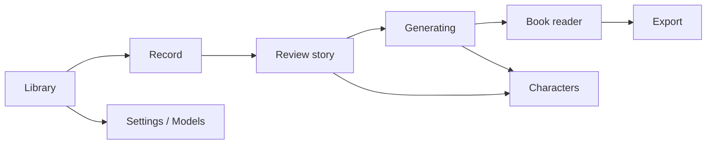

# UI design

Direction from the brief: **muted grays and blacks, inspired by Nothing UI.** The first prototype is command-line scripts, so this document guides Phase 2.

## 1. Principles

- The app chrome is quiet and monochrome so the colourful generated illustrations are the only saturated thing on screen.
- Large type, generous spacing, a small number of shapes.
- One restrained accent for the primary action and recording state.
- Dark by default; a light variant uses the same tokens inverted.

## 2. Design tokens

```css
:root {
  /* surfaces (dark default) */
  --bg:            #0b0b0c;   /* app background */
  --surface-1:     #141416;   /* cards, panels */
  --surface-2:     #1c1c1f;   /* raised elements, inputs */
  --border:        #2a2a2e;

  /* text */
  --text:          #e6e6e8;
  --text-muted:    #8c8c93;
  --text-faint:    #5a5a61;

  /* accent: a single muted red used for record + primary action */
  --accent:        #d4503f;
  --accent-ink:    #0b0b0c;

  /* status (kept desaturated) */
  --ok:            #7fa38a;
  --warn:          #c9a35b;
  --danger:        #c0594d;

  --radius-s: 8px;  --radius-m: 14px;  --radius-l: 24px;
  --font-ui:   "Inter", system-ui, sans-serif;
  --font-mono: "JetBrains Mono", ui-monospace, monospace;   /* labels, numbers, status */
  --font-display: "Space Grotesk", sans-serif;               /* titles; dot-matrix accent optional */
}
```

Light variant swaps `--bg` to `#f1f1f2`, surfaces to whites/light grays, text to near-black, keeping the same accent.

Notes: confirm font licences before bundling; check contrast (WCAG AA) for `--text-muted` on `--surface-1`.

## 3. Motifs

- Monospace, uppercase micro-labels for state (`LISTENING`, `PAGE 2/5`, `GENERATING`).
- Dot-grid or dot-matrix progress indicators instead of spinners.
- Pill buttons; circular record button with a ring that pulses with input level.
- Illustrations sit in rounded frames on a neutral mat so the muted UI never competes with them.

## 4. Screens and flow



| Screen | Purpose | Key elements |
|---|---|---|
| **Library** | List saved books | Cover grid (first page image), new-book button, delete |
| **Record** | Capture the story | Large record button, live level meter, timer, pause, re-record, optional typed-text fallback |
| **Review story** | Check transcript and page plan before spending GPU time | Transcript, editable page cards (story text, scenario, effects, camera, render mode `layered`/`ref_compose`/`composite_refine`/`full_scene`, characters and positions), fields the planner invented (`inferred_fields`) shown in a different tint with a one-click confirm, page-count 4–6, style picker, warning banner only if the optional text check is enabled |
| **Characters & places** | Approve the look of each character and location | Editable spec fields (hair, build, height, headwear, eyewear, outfit …) with live prompt preview and inferred (guessed) fields highlighted; asset gallery of poses and expressions per character and plates per environment; "regenerate this asset"; reuse from library; critic checklist (hood colour = red …) |
| **Generating** | Progress for long jobs | Two lanes: assets (plates, character poses) then pages; per-page dot progress, current stage (transcribe / plan / assets / compose / check), cancel, per-page retry, critic result chips (✓ hood red, ✗ hair) |
| **Book reader** | Read the finished book | Full-page picture + story text, swipe/arrow page turns, flag-warning badge on pages the critic could not verify, regenerate page |
| **Page layout editor** (Phase 3) | Fix a layered page without regenerating | Drag characters, change depth/flip/scale, swap plate or pose asset, toggle render mode, re-compose in seconds |
| **Export** | Share or print | PDF, PNG set, page size, include text toggle |
| **Settings / Models** | Hardware and backends | Detected GPU/RAM, model list with licence and "personal use only" badge, backend selection, llama binary path/version, storage use |

## 5. Interaction notes

- Generation takes minutes; the UI must always show which stage is running and allow cancel without losing completed pages.
- Because assets are cached, editing one spec field (say giving a character a fedora) only regenerates that character's assets and re-composes the affected pages; the UI should say what will be regenerated before it starts.
- Failed critic checks are shown in plain language ("Her hood looks blue; expected red") with Retry / Keep anyway.
- First run: a checklist page that detects GPU, models and the `llama` binary and explains anything missing.
- Accessibility: keyboard navigation, focus rings, reduced-motion setting, text size control in the reader, read-aloud later.
- Responsive: desktop window minimum 900×600; layouts scale for a future tablet/phone client without changing component structure.


## Review and redraw (added 2026-10-11)
On the Review screen every page is shown at full size with a short checklist (two hands and two legs each, each character once, standing on something, the page shows its sentence, same hair and clothes) and small computer notes. Each page has a **Redraw** button (new random seed, about 30-45 s) and a version strip with the earlier pictures and **Undo**. The checklist exists because no model, local or frontier, reliably sees extra hands or legs. Redraw state per page is `regen_log.json` (`attempt`, `archive`).


## Routes (implemented in the thin slice, 2026-10-11)
| Route | Screen | State |
|---|---|---|
| `/` | Library: cover grid, status chip, delete, refresh; damaged folders listed with the reason | built |
| `/new` | New book: typed story or audio file, style, pages | built |
| `/book/[id]` | redirects to generating or review by status | built |
| `/book/[id]/generating` | live stage list, progress bar, elapsed time, Cancel, error details, Try again | built |
| `/book/[id]/review` | full-size pages, checklist, computer notes, Redraw, select several, earlier drawings, Undo, Open PDF / folder, lightbox | built |
| `/settings` | engine state and GPU, library folder, default style and pages | built |
| `/record`, `/book/[id]/characters`, `/book/[id]/export` | placeholders ("coming next") | stubs |

## Added in the second milestone (2026-10-11)
| Route | Screen | State |
|---|---|---|
| `/setup` | Is everything installed? Ten checks, each with a plain fix and a "copy the command" button; opens by itself (once) when something blocks | built |
| `/book/[id]/characters` | Characters and places: picture or "not drawn yet", every field as a plain form (drop-downs from the models, outfit list), "guessed" marks on invented fields, Save / Discard banner, per-card Draw / Draw again, "Draw characters and places", "Looks good: draw the pages"; read-only once pages exist or the book is finished | built |
| `/record` | Record: big record button, live level meter with peak hold, timer (of 15:00), Pause/Continue, Finish; then the length, a player, title, style, pages, "Record again" and "Use this recording"; clear messages for no microphone, busy microphone and denied permission | built |
Flow with approval on: New book -> Generating (plan) -> Characters (edit, draw, redraw) -> Generating (pages) -> Review. While a job runs the forms are locked and a progress bar with Cancel is shown.
